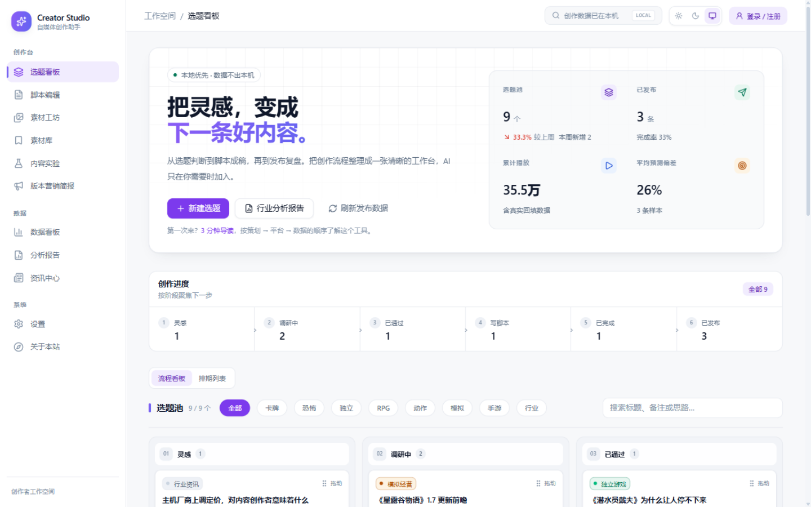
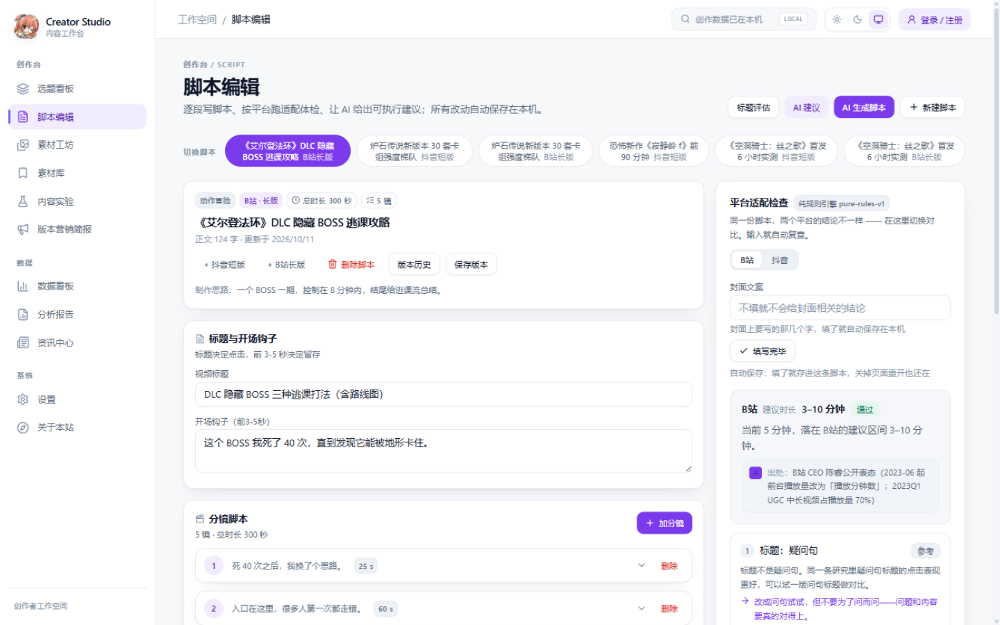
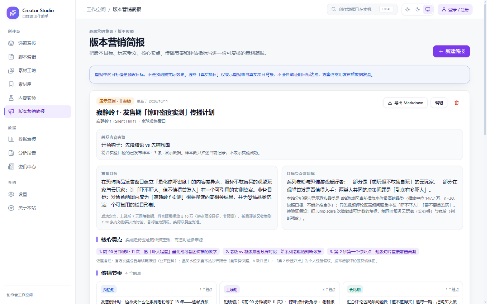
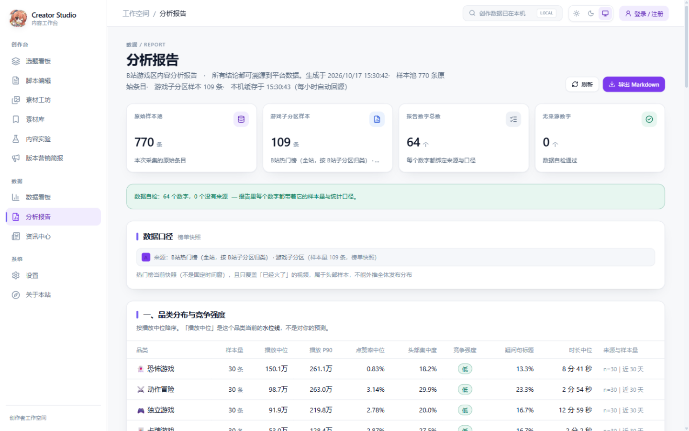

# Creator Studio · 游戏内容选题与复盘工作台

**在线体验**：**[https://creator.creator-app.xyz](https://creator.creator-app.xyz)**（可用性与账号/云同步能力取决于当前部署配置）
**代码**：[github.com/gdaksgd/creator-studio](https://github.com/gdaksgd/creator-studio)，仓库保留了 `v1.0.0` → `v1.5.2` 的历史版本快照，可用于对照版本演进。

## 界面速览

| 选题看板：热点评分与选题池 | 脚本编辑：按平台给出适配结论（B站/抖音结论不同） |
|---|---|
|  |  |

| 版本营销简报：目标、受众、卖点与传播节奏 | 分析报告：每个数字都带来源与样本量 |
|---|---|
|  |  |

## 项目速览

| 项目维度 | 项目中的代表性内容 | 阅读口径 |
|---|---|---|
| **内容运营工作流** | 选题评估、脚本与素材、平台适配、发布回填、复盘与内容实验 | 产品能力；不代表已验证的账号增长效果 |
| **游戏营销策划** | 版本目标、受众、卖点依据、预热/上线/长尾节奏与评估指标的简报结构 | 策划工具；计划值不是实际执行或达成结果 |
| **数据与工程实现** | 公开样本分析、来源与样本量标注、本地数据管理、报告导出 | 历史样本不代表实时市场；云端功能以部署配置为准 |

---

## 目录

- [界面速览](#界面速览)
- [项目速览](#项目速览)
- [Creator Studio 项目](#creator-studio-项目)
- [目标岗位能力映射](#目标岗位能力映射)
- [一、它把内容运营最常问的问题变成可查的工作流](#一它把内容运营最常问的问题变成可查的工作流)
- [二、对内容运营、创作者运营与游戏营销策划的价值](#二对内容运营创作者运营与游戏营销策划的价值)
- [三、项目数据与证据口径](#三项目数据与证据口径)
- [四、功能一览](#四功能一览)
- [五、在线体验](#五在线体验)
- [六、版本演进：能力是怎么一步步长出来的](#六版本演进能力是怎么一步步长出来的)
- [七、为什么这些结论可信（实现层面）](#七为什么这些结论可信实现层面)
- [八、这套系统里我做了什么](#八这套系统里我做了什么)
- [九、技术栈](#九技术栈)
- [十、系统架构](#十系统架构)
- [十一、本地运行](#十一本地运行)
- [十二、目录结构](#十二目录结构)
- [十三、运维](#十三运维)
- [十四、常见问题](#十四常见问题)
- [十五、已知限制](#十五已知限制)

> 时间有限可以先读：**一、二、四**（项目解决的问题与产品能力）、**三**（数据口径与证据边界）；**七、十~十三** 是工程实现细节，按需查阅。

---

## Creator Studio 项目

**游戏内容选题与复盘工作台｜产品 / 数据 / 开发｜2026.06–至今**

Creator Studio 是独立个人项目，通过一个可操作的工作台呈现内容生产、发布复盘和版本传播策划的产品设计与工程实现；不代表任何雇主或业务团队使用了该系统。

- **内容工作流**：将选题评估、脚本与素材、平台适配、发布数据回填和复盘组织为一套流程，支持脚本与历史版本留档。
- **公开样本分析**：历史项目版本使用过 B 站游戏区公开样本建立品类基准线；样本仅代表对应采集时间、来源与筛选范围，不代表个人账号表现或当前实时行业数据。
- **报告与校准**：分析报告支持呈现来源、样本量和时间窗并导出 Markdown；预测校准以可追溯的发布记录为输入，不把单条案例包装成普遍提升结论。
- **新增工作台模块**：内容实验用于记录假设、变量、分组、样本和人工复盘；版本营销简报用于组织目标、人群、卖点依据、传播阶段与评估指标。计划值不会被自动表述为达成结果，样本不足时不作成功判断。
- **技术栈**：React、TypeScript、Node.js；当前代码还使用 Vite、Zustand、Dexie / IndexedDB 等实现组件。
- **访问与验证**：[项目访问入口](https://creator.creator-app.xyz)；线上可用性及云同步能力以当前部署为准。当前工作树的功能和构建状态见下文，不用历史测试或 README 描述替代实际验证。

## 目标岗位能力映射

| 目标岗位方向 | 项目重点 | 可查看的项目证据 |
|---|---|---|
| **内容运营 / 内容策划** | 从选题到脚本、平台适配、发布回填和复盘的内容链路 | 选题看板、脚本编辑器、平台检查、发布记录与内容实验模块 |
| **创作者运营** | 将内容方向沟通与发布后复盘组织为可追踪流程 | 项目支持内容与表现管理；不提供创作者 CRM、合同或激励结算 |
| **游戏营销策划 / 版本营销** | 将版本目标、受众、卖点依据、传播阶段与评估指标组织成简报 | 版本营销简报支持结构化策划；不代表真实执行，也不自动生成业绩结论 |

> 项目用于展示岗位相关的方法与工具实现。个人实习经历与业务结果请放在简历或单独的经历说明中，不在本 README 复述。

### 当前能力与证据边界

- **已实现、可本地演示**：选题与脚本流程、平台规则检查、发布回填、复盘标签、内容实验记录、版本营销简报、排期和素材收藏。
- **公开样本不等于个人成绩**：公开平台样本和报告数字用于展示分析方法；只有明确来源的个人发布记录才能作为个人内容效果。当前没有经过对照验证的普遍“播放提升”结论。
- **实验状态诚实表达**：内容实验样本数不足时显示「样本不足」；假设、人工结论和下一步行动不代表工具已证明因果关系。
- **简报不是执行结果**：营销简报的目标值是计划指标，不是模型预测或已达成业绩；“演示案例”与“真实项目背景”分开标记。
- **验证边界**：云端多账号隔离、线上 Supabase 和个人真实业务效果应分别在可访问的目标环境中验证，不以本地类型检查代替。

---

## 一、它把内容运营最常问的问题变成可查的工作流

| 日常要面对的问题 | 这个工具给出的答案 | 依据从哪来 |
|---|---|---|
| **「这个选题值不值得做？」** | 在可用样本范围内查看品类播放分位、互动率与头部集中情况；样本不足时不给水位线结论 | 历史采集的 B站公开样本；当前数据规模与新鲜度须以运行环境中的实际数据为准 |
| **「这条脚本发 B站 还是抖音？」** | 同一份脚本，两个平台**给出不同结论**：B站 3–10 分钟 `pass`，抖音 1–3 分钟 `warn` 并给拆条建议；另有标题疑问句、标题情绪、封面情绪、标题党反向清单 4 条规则（发布后才知道的 CTR / 完播率 / 更新频率已删除——那些数字该去看板看） | 每条规则都带**证据等级 A/B/C**（同行评审论文 / 平台官方文档 / 第三方大样本 / 本项目自定义阈值），拿不到输入的检查**直接不出现**而不是写一句「不填就不会给结论」占位 |
| **「发完到底准不准？」** | 把 AI 的**预估播放**和 B站**真实播放**对上：平均绝对偏差、系统性高估/低估、逐条偏差清单；缺一边的数据的样本单列，**绝不补 0** | 粘贴视频链接精确取数（BV 号 / av 号 / b23.tv 短链），不走会静默失败的自动匹配 |
| **「汇报时被问『这数字哪来的』怎么办？」** | 分析报告为样本数字记录来源、样本量、时间窗和统计方法，并可导出 Markdown | 报告数据结构与来源标注；历史自检结果不代表当前部署数据或本轮构建状态 |

---

## 二、对内容运营、创作者运营与游戏营销策划的价值

Creator Studio 将内容生产与版本传播中的常见工作拆成可执行的产品流程。重点不是堆叠功能，而是让输入、判断依据、执行步骤与复盘结果能在同一工作台中衔接。

| 岗位任务 | 项目提供的思路 / 工具 | 设计重点 |
|---|---|---|
| **内容运营 / 内容策划**：选题、脚本、跨平台调整、发布后复盘 | 从选题到发布数据回填的内容链路 | 缺失数据不补 0；样本与口径不足时不强行给结论 |
| **创作者运营**：内容方向沟通、合作内容管理与表现复盘 | 以选题、脚本和发布记录承接内容协作 | 本项目不是 CRM，不处理合同、结算或创作者关系管理 |
| **游戏营销策划 / 版本营销**：明确受众、卖点、传播节奏和评估方式 | 版本营销简报记录目标、人群、卖点依据、预热/上线/长尾触点及指标定义 | 方案目标与实际执行结果分开记录，不自动生成业绩结论 |
| **数据与流程改进**：减少重复劳动，让结果可追溯 | 样本门槛、来源标注、规划/演示/真实项目背景区分、本地备份与同步路径 | 数据来源和验证状态与结论一起呈现，便于复核和交接 |

**项目希望展示的能力组合**：将岗位任务拆成用户流程、指标定义、证据边界和可操作的产品实现，并为后续复盘留下结构化记录。

---

## 三、项目数据与证据口径

本节描述的是项目使用的公开平台样本与产品能力，不代表个人账号表现或该工具已产生的业务提升。内容实验默认将 `demo-` 演示选题排除在真实样本之外。简报目标值是策划输入，不是已达成 KPI。

| 项目能力 / 样本说明 | 项目描述 | 口径边界 |
|---|---|---|
| 历史基准样本 | 历史版本曾使用 770 条 B站公开样本；不作为当前在线数据规模承诺 | 以仓库历史样本文件及其采集口径为准；采集时间影响代表性 |
| 报告能力 | 支持多维度报告、来源说明与 Markdown 导出；指标数量随数据及实现版本变化 | `GET /api/report/game-industry(.md)`；运行时自检需在目标环境重新执行 |
| 平台适配规则 | 规则标注来源与 A/B/C 证据等级；阈值含项目自定义项 | 规则引擎实现与当前配置；不代表平台算法或 KPI |
| 质量验证 | 仓库包含构建、静态检查、流程探针与浏览器/HTTP 测试脚本 | 每次交付需以当次命令输出和目标环境结果为准；历史通过记录不等同于当前通过 |

> 历史实现记录也包含已知限制：曾无法稳定自动列出指定账号的全部视频，因此采用「粘贴链接精确取数」；时长曲线按样本门槛过滤，冷启动期可能缺段。接口表现和阈值以当前代码与运行环境为准。

> **本地功能验证**：启动前后端后可在脚本编辑器检查平台适配规则；在线访问与数据持久化需分别在目标部署环境验证。

---

## 四、功能一览

| 模块 | 说明 |
|---|---|
| **资讯中心** | 定时从 RSS / YouTube / B站 / Steam 采集资讯与热门视频，按品类自动落桶，一键存为选题；**RSS + B站每小时一采**（不吃 YouTube 配额），含 YouTube 的完整轮 6 小时一次；页面数据另有**一小时本地缓存**，一小时内再打开不再回源（提示「缓存 · 几分钟前」），点「刷新」可立刻回源 |
| **选题看板** | 按品类筛选、按优先级排序；状态流转（想法 → 调研 → 已通过 → 写脚本 → 已完成 → 已发布），发布后粘贴链接即可回填真实数据 |
| **脚本编辑器** | 结构化脚本编辑（开场钩子 / 分镜 / 结尾），AI 生成选题评估与标题评分，支持重新生成与历史保留 |
| **平台适配检查** | 粘贴标题与封面文案，选 B站 或抖音，输出最多 4 条带出处与 A/B/C 证据等级的结论（拿不到输入的规则直接不出现，不排占位行）；没配 AI 也能跑，AI 只在你点按钮时润色文案。填的封面文案**填了就存进这条脚本**（关页面、刷新、换脚本再回来都还在），停手 400ms 自动复查一次，也可以点「填写完毕」立刻复查 |
| **预测校准** | AI 预估播放 vs B站 真实播放：平均绝对偏差、系统性高估/低估、逐条对比；缺数据的样本单列，不补 0 |
| **品类基准线** | 从真实样本算出各品类播放分位与互动率水位线，强制显示样本量与时间窗；AI 结论据此带上「数据依据」 |
| **数据看板 / 运营统计** | 双平台账号指标（B站粉丝 / 播放 / 获赞 / 视频数、抖音本地填写值）、同步历史、增长趋势与「预测 vs 实际」复盘，每个数字写明来源与口径；账号统计与同步历史合并成一个 `GET /api/ai/account/overview`（服务端复用同一份云端快照，不为两个接口各读一次），前端放**一小时本地缓存**、过期时先用旧数据渲染再后台回源——本机实测打开 1.4 秒 → 0.43 秒，一小时内再打开完全不发请求（提示「缓存 · 几分钟前」），点右上角「立即同步」可立刻回源；品类基准线同样一小时缓存，点「重新采集」才强制重采 |
| **分析报告** | 《B站游戏区内容分析报告》：品类竞争强度 / TOP 作品标题模式 / 时长–互动率 / 发布时段分布 + 对自己选题的建议；每个数字带样本量与口径，可导出 Markdown。报告接口同样**一小时本地缓存**，避免每次打开都重传整份报告 |
| **素材工坊 / 素材库** | AI 按分镜提出素材建议；用户可收藏外部素材引用，按类型、品类、标签和收藏夹整理，并关联脚本。当前保存的是链接引用，不上传或托管原始媒体文件 |
| **内容实验** | 记录可证伪假设、单一变量、观察指标、关联内容、样本门槛和人工下一步；不足最低样本时显示「样本不足」，不自动宣称因果或成功 |
| **版本营销简报** | 本地组织目标、人群、洞察、卖点证据、预热/上线/长尾传播计划和指标，支持导出 Markdown；规划目标不等于模型预测或已实现业绩 |
| **本地数据与备份** | 主要数据保存在浏览器 IndexedDB，可导入/导出本地 JSON 备份；切换账号或设备前应先确认备份与同步状态 |
| **账号与云同步** | 前端提供登录与同步流程；云端同步依赖服务端/Supabase 配置，部署端未配置时可使用的能力以本地功能为主 |

**支持的创作品类（配置文件里可自由增删）**：
🃏 卡牌游戏 · 👻 恐怖游戏 · 🎮 独立游戏 · 🗡️ RPG/剧情向 · ⚔️ 动作冒险 · 🏗️ 模拟经营 · 📱 手游 · 📰 行业资讯
（另有仅供资讯采集落桶的「📌 综合资讯」，不参与创作选题。）

---

## 五、在线体验

| 场景 | 地址 |
|---|---|
| **项目访问入口** | **[https://creator.creator-app.xyz](https://creator.creator-app.xyz)**（部署状态以实际访问结果为准） |
| 本机生产模式 | http://localhost:3001 |
| 本机开发模式（热更新） | http://localhost:5173 |

线上地址为项目配置的访问入口；当前服务可用性、静态资源与账号能力应以实际部署状态为准。

**第一次用怎么上手**：若当前部署启用了演示数据，可在本机浏览流程；演示内容并非个人成绩。重要记录建议先通过「设置」导出 JSON 备份。账号注册、跨设备同步是否可用，取决于部署侧 Supabase 与服务端配置；账号制实现说明见 [`docs/account-system.md`](docs/account-system.md)。

---

## 六、版本演进：能力是怎么一步步长出来的

这个仓库不是「一次性写完」的，而是按里程碑长出来的，每一版都打了 tag、可以直接检出对照：

| 版本 | 里程碑 | 这一版做了什么 | 代码 |
|---|---|---|---|
| `v1.0.0` | 最初版本 | 资讯 / 选题 / 脚本 / 素材四大模块 + 云端同步 + 密码门 | [tree](https://github.com/gdaksgd/creator-studio/tree/v1.0.0) |
| `v1.1.0` | **M0 工程化加固** | 去掉密码门、品类收成单一事实来源、db 改原子写、分层限流 + 每日配额、自检/备份/保活脚本 | [tree](https://github.com/gdaksgd/creator-studio/tree/v1.1.0) |
| `v1.2.0` | **M1 选题–结果闭环** | 粘贴 B站链接取回真实播放/点赞/投币/收藏/分享/评论，把 AI 的「预估播放」和真实数据对上并算偏差；缺数据的样本单列，不补 0 | [tree](https://github.com/gdaksgd/creator-studio/tree/v1.2.0) |
| `v1.3.0` | **M2 品类基准线** | 从 B站游戏区真实样本算出各品类播放分位与互动率水位线（强制显示样本量与时间窗），AI 结论据此带上「数据依据」 | [tree](https://github.com/gdaksgd/creator-studio/tree/v1.3.0) |
| `v1.4.0` | **M3 分析报告生成** | 把工具的能力变成一件**可导出的作品**：《B站游戏区内容分析报告》——每个数字都带样本量与口径，可导出 Markdown | [tree](https://github.com/gdaksgd/creator-studio/tree/v1.4.0) |
| `v1.5.0` | **M4 封面 + 平台适配** | 把学术结论和官方文档变成**可执行的检查器**：同一份脚本两个平台结论不同；9 条规则逐条标注出处与 A/B/C 证据等级；纯规则引擎，没有 AI 也能给出全部结论 | [tree](https://github.com/gdaksgd/creator-studio/tree/v1.5.0) |
| `v1.5.1` | **M4 修正：面板输入不再丢** | 真机用下来暴露的问题：手填的封面文案关掉页面就没了，结论也不跟着输入更新。改法是把输入存进脚本记录（IndexedDB + 云同步），并给纯规则检查单开 120 次/分 的宽松档（原先它和 AI 共用 20 次/分 的档，边打字边被 429 拦住，看起来就像「不更新」），再加一个「填写完毕」按钮立刻复查 | [tree](https://github.com/gdaksgd/creator-studio/tree/v1.5.1) |
| `v1.5.2` | **M4.2 精简平台适配面板** | 真机再跑一遍，用户指出面板里有一批「只给参考、没有任何分析」的行。删掉 5 条：封面像素（本工具只读文案、不分析像素）、CTR 参考线（B站/抖音 都没有公开接口，只能手填，且只有 YouTube 口径）、更新节奏（频道级习惯，不是单条脚本的适配问题）、完播率分档（B站恒为「不套用」，抖音要发布后数据）、与时长卡重复的一致性检查。同时定下新原则——**拿不到输入的规则直接不出现**，不再排一行「不填就不会给结论」的占位；发布后指标连同三个输入框一起删除。规则从 9 条收敛到 4 条 | [tree](https://github.com/gdaksgd/creator-studio/tree/v1.5.2) |

> 历史版本的构建记录属于对应 tag 的历史状态，不代表当前工作树或线上部署状态；当前提交请以本轮构建和目标环境验收结果为准。

**两个被实测推翻的原计划**（记在这里，因为它们比结果更能说明判断过程）：

1. **「自动列出自己账号全部视频再按标题匹配回填」→ 放弃。** 实测 `/x/space/wbi/arc/search` 稳定返回 `-352 风控校验失败`（带 WBI 签名与 `buvid3` cookie 也一样），而 `/x/web-interface/view` 单条取数 8/8 成功。改走「粘贴链接精确取数」，顺带消灭了「标题匹配错人」这一整类错误。
2. **「用 B站排行榜做品类基准」→ 放弃。** 实测榜单条目**中位年龄 552 天**，是一份长期冻结的快照，拿来算「当前水位线」会完全失真；而且它答错了问题——排行榜能回答「现在什么在火」，回答不了「恐怖游戏这个品类的正常水位是多少」。改用可控制时间窗的搜索源（对照实验：`days=30 → maxPlay 276 万`，`days=3650 → 3248 万`）。
   结论：**「有哪些数据源」和「哪个数据源能回答这个问题」是两件事。**

---

## 七、为什么这些结论可信（实现层面）

### 7.1 数据诚实是类型级别的约束，不是自觉

最容易做错的事，是**用 `0` 冒充「没有数据」**。这个项目原来的代码就是这样：`Topic.estimatedViews` 在新建选题时写入 `0`，然后在**整个代码库里从未被读取过一次**。

现在的硬规则：**每个展示给用户的数字都必须有出处**，拿不到就显示「暂无数据」，绝不用 `0` 或占位数字代替。落地方式是让「出处」成为数据结构的一部分：

```ts
ReportMetric {
  label: '播放中位数', value: 1069000, display: '106.9万', unit: 'views',
  basis: { source: 'bilibili-popular', sourceLabel: 'B站热门榜·单机游戏',
           sampleSize: 30, windowDays: null, collectedAt: 17…, method: '中位数' }
}
```

渲染层（JSON 与 Markdown 共用同一份数据）**没有「只打印数字」的代码路径**：表格里每个数字右边都跟着一列「来源与样本量」。
再往上一层是程序自检：`validateReport()` 递归遍历整份报告，数出「一共有多少个数字、其中多少个没有出处」，写进 `selfCheck { metricCount, unbackedMetricCount }`；冒烟测试直接断言 `unbackedMetricCount == 0`——数字一旦失去出处，测试就红。

AI 那一边同理：**AI 说「预估 5-10 万」时，用户有权知道这个数字是算出来的还是猜的**。

```
品类基准线（后台采集）→ B站搜索「近 30 天 · 按播放量排序」30 条样本
   ↓ 中位数 / P25 / P75 / P90；样本量不足 15 条整条不发布
注入 AI 提示词       → 「来源｜时间窗｜样本量｜播放分位｜互动率」+ 引用要求
   ↓ basis 由服务端按真实样本计算，模型无法自己声明「我有数据支撑」
响应里的 basis       → source=benchmark{样本量 30, 时间窗 30 天, 分位 P62}
                      / source=ai（没有样本，界面直接标「纯 AI 推断，未经数据校验」）
```

### 7.2 判断权交给规则引擎，AI 只做文案

`server/src/services/platformRules.ts` 是一个**零依赖的纯规则引擎**（`RULE_ENGINE_ID = 'pure-rules-v1'`）：输入标题、封面文案、预计时长，输出最多 4 条结论（发布后的 CTR / 完播率 / 更新频率已不属于这里的判断范围，对应输入框也一并删除）。它不认识任何大模型 API，也不读环境变量——**没有 `DEEPSEEK_API_KEY` 时功能完全可用**。AI 只在用户主动点击时被调用，提示词里明写「不要编造任何数据、播放量、排名、奖项」，规则结论作为硬约束传进去；纯规则调用不消耗每日 AI 配额。

每条规则的出处是**必填字段**，不是可选备注：

```ts
export interface PlatformRule {
  id: string;
  label: string;
  status: 'pass' | 'warn' | 'fail' | 'info';
  detail: string;
  hint?: string;
  evidence: { source: string; level: 'A' | 'B' | 'C'; note?: string };  // 每条都必须有
}
```

| 证据等级 | 含义 | 例 |
|---|---|---|
| A | 同行评审论文 / 平台官方文档 | Cui et al. (2024) JBR 183:114849（16,215 个 YouTube 封面）；B站 前台播放量改为播放分钟数的公开表态 |
| B | 第三方大样本转述 | 转述的抖音完播率分档（明确标注「非官方原文，只作参考区间」） |
| C | 经验帖 / 本项目自定义阈值 | 「强情绪词 20 个」「标题党词 9 个」这类词表 |

`summary` 里必须满足 `sourced === total`，冒烟测试直接断言。**不知道就不出现在界面上**：不填标题就不出现标题类规则，不填封面文案就不出现封面类规则——v1.5.1 及以前会排一行 `info` 的「不填就不会给结论」，实机用下来那句话被用户判定为纯噪音，v1.5.2 起直接不出行（冒烟测试断言「无输入 → 0 行规则」）；只给「参考」、没有分析余地的规则（封面像素、CTR 参考线、更新节奏、完播率分档）整体删除。

### 7.3 同步不静默覆盖、数据不半截

早期实现的致命缺陷：云端查询失败时返回空数据，与「云端本来就没有数据」无法区分，于是本地空数据会**静默覆盖**云端真实数据。现已在接口语义层面堵死：

| 场景 | HTTP | 响应 |
|---|---|---|
| Supabase 未配置 | `503` | `{ code: 'NOT_CONFIGURED' }` |
| 查询失败 | `502` | `{ code: 'CLOUD_ERROR' }` + 服务端日志 |
| 成功但无数据 | `200` | `{ topics: [], scripts: [], uploadedAt: 0, empty: true }` |
| 成功有数据 | `200` | 正常数据 + `empty: false` |

上传接口带乐观锁 `baseUploadedAt`：云端已被其它设备更新时返回 `409 CONFLICT` 而**不执行写入**，前端自动转为下载。本地 `db.json` 采用 `写临时文件 → fsync → rename` 的原子写，解析失败时把坏文件重命名为 `db.json.corrupt-<时间戳>` 留证后回退默认值。

**云端数据从「公开单行」改成「账号制」**：改造前两个同步接口**没有任何鉴权**，任何人访问 `/api/sync/download` 就能拿到全部云端数据（实测 HTTP 200）。现在：

| 项 | 处理 |
|---|---|
| 鉴权 | `/api/sync/upload`、`/api/sync/download` 必须带 `Authorization: Bearer <token>`，缺/过期返回 `401 { code: 'UNAUTHORIZED' }`；请求体里的 `userId` 一律忽略，只认 token 里的身份 |
| 隔离 | 设计上每个账号在云端有独立数据；隔离能力需通过已配置的 Supabase 环境进行真实多账号验证 |
| 口令 | `node:crypto` 的 scrypt（N=16384, r=8, p=1, keylen=32）加盐哈希，`timingSafeEqual` 校验，登录时用户不存在也跑一次 scrypt 防枚举 |
| 令牌 | 无状态 HMAC-SHA256（`userId.exp.signature`，90 天），密钥取 `AUTH_SECRET`，没配就自动生成并持久化到 `server/data/auth-secret.txt` |
| 迁移 | 改造前那一行的老数据自动进 `legacy` 字段**一条不丢**，且没有任何接口会返回它；本人注册后用 `cloud-admin.ts adopt-legacy <用户名>` 认领 |
| 限流 | 注册 5 次/10 分钟、登录 12 次/分钟（按 IP），另有 429 + `Retry-After` |
| AI Key | `/api/ai-config`（GET/PUT/POST `test`，需登录）让每个账号保存**自己**的 DeepSeek Key：AES-256-GCM 加密后与选题/脚本存在同一份账号数据里，接口只回掩码；本账号 Key 优先，没有才回落到站点公共 Key |

### 7.4 运行安全与 AI 成本

| 项 | 处理 |
|---|---|
| 访问控制 | 移除原先的 6 位数字共享密码；云端数据改为**账号制**（scrypt 口令 + 90 天 HMAC 令牌 + 按账号隔离），未登录的同步请求一律 401，服务端密钥仍不暴露给前端 |
| 源码暴露 | 线上只服务生产构建，`/src/**.tsx` 不可达 |
| CORS | 白名单：仅本机开发端口与同源放行，其它不回 `Access-Control-Allow-Origin` |
| 请求体 | `express.json` 上限收紧到 `2mb` |
| 限流 | 零依赖内存实现的分层限流：`/api/ai/*` 60s/20 次、采集 600s/3 次、其它 `/api/*` 60s/120 次，响应带 `X-RateLimit-*` 头 |
| AI 成本 | 每日配额（默认 300），只读 GET 与纯规则调用**不消耗**配额 |
| 密钥 | 站点公共 Key（DeepSeek / YouTube）全部走 `server/.env`，已 gitignore，**从未进入版本库**；用户自己的 DeepSeek Key 存在**他自己的账号数据**里（AES-256-GCM，不落明文、不回明文），设置页也不再教用户去改服务器文件 |

### 7.5 质量闸门

- `tools/hooks-audit.mjs` 提供 React hooks 顺序静态体检；构建状态请以当前工作树实际运行结果为准；
- 仓库包含 `tools/smoke-test.ps1`、`tools/panel-e2e.mjs`、`tools/hourly-cache.mjs` 等验证脚本；脚本及历史通过记录不能代替对当前提交和目标部署的重新执行；
- `tools/product-workflow-probe.mjs` 是源码级流程探针，不等于真实浏览器端到端验收；线上账号隔离需在已配置 Supabase 的环境单独验证；
- 移动端 390 / 768 / 1440 三档宽度实测无横向溢出。

---

## 八、这套系统里我做了什么

从需求定义到产品实现，项目覆盖以下工作：

| 环节 | 具体工作 |
|---|---|
| **产品定义** | 把「选题靠感觉」拆成可执行的数据动作：品类水位线、预测校准、跨平台适配、可导出报告；并定下「无来源不给数字」的硬约束 |
| **数据口径设计** | 选择数据源并做对照实验（榜单 vs 搜索时间窗）、定义分位/中位/互动率口径、设置样本门槛、设计 `basis` 与证据等级 A/B/C 的表达方式 |
| **前端** | React 19 + TypeScript + Vite + Tailwind + Zustand + Dexie，实现资讯 / 选题 / 脚本 / 素材 / 运营 / 数据看板 / 分析报告 / 素材库 / 内容实验 / 版本营销简报 10 个页面与平台适配检查面板，含移动端适配 |
| **后端** | Node 22 + Express 5：采集器（RSS / YouTube / B站 / Steam）、基准线服务、报告生成与 Markdown 渲染、视频取数、零依赖规则引擎、分层限流与每日配额 |
| **数据与同步** | 本地优先的数据模型、同步冲突处理与备份路径；云端同步需结合部署配置验证 |
| **测试与验证** | 仓库包含流程探针、冒烟、静态体检和浏览器验证脚本；结果应按当前代码和目标环境重新确认 |
| **部署与运维** | 仓库包含部署、保活、备份和日志排查相关配置；线上运行状态需在目标环境核实 |
| **文档** | 产品升级计划书（里程碑、验收标准、风险登记册）、README、报告导出件与复盘材料 |

> 本项目展示的是产品设计和工程实现，不把历史公开样本或演示数据描述成项目带来的业务增长。

---

## 九、技术栈

**前端**：`React 19` · `TypeScript` · `Vite` · `Tailwind CSS v4` · `Zustand` · `Dexie (IndexedDB)`
**后端**：`Node.js 22` · `Express 5` · `node-cron` · `tsx`
**基础设施**：项目包含 `Cloudflare Tunnel` 与 `Supabase PostgreSQL` 接入实现；是否启用及线上配置需以目标部署环境为准

---

## 十、系统架构

```
                      ┌──────────────────────────────────────┐
   浏览器 / 客户端 ───▶│  公网入口（如启用 Cloudflare Tunnel）  │
                      └────────────────┬─────────────────────┘
                                        │ 项目部署配置
                                       ▼
   ┌──────────────────────────────────────────────────────────────┐
   │  本机 Windows（内置 Node v22.22.2，不依赖系统环境）             │
   │                                                              │
   │   生产模式 ──▶ Express :3001                                  │
   │                ├─ 托管前端构建产物（server/public，纯静态）      │
   │                └─ /api/**  业务接口                            │
   │                                                              │
   │   开发模式 ──▶ Vite :5173  ──/api 代理──▶ Express :3001        │
   └───────────────────────┬──────────────────────────────────────┘
                           │ 定时采集 / 数据同步
                           ▼
   ┌──────────────────────────────────────────────────────────────┐
    │  Supabase PostgreSQL（可选，需部署配置）                       │
    │  app_sync · 按账号组织的同步数据                               │
   └──────────────────────────────────────────────────────────────┘
```

---

## 十一、本地运行

### 一键启动（推荐）

```powershell
powershell -ExecutionPolicy Bypass -File autostart.ps1
```

脚本设计为构建前端（若未构建）→ 启动 Express :3001 → 启动 Cloudflare 隧道。是否已配置开机自启及公网可访问性，应在实际运行环境确认。

### 常用脚本

| 脚本 | 用途 |
|---|---|
| `publish.bat` | 构建并重启本机服务；是否对公网生效取决于部署拓扑 |
| `stop.bat` / `stop.ps1` | 停掉后端 + 开发服务器 + 隧道 |
| `start-dev.bat` | 开发模式：Vite :5173 热更新 + 后端 |
| `start-tunnel.bat` | 只启动 Cloudflare 隧道 |
| `start-frontend.bat` / `start-backend.bat` | 单独启动，前台可见日志，调试用 |
| `build.ps1` | 只做生产构建（构建前先跑 React hooks 顺序体检），产物复制到 `server/public` |
| `tools/hooks-audit.mjs` | React hooks 顺序静态体检，拦截「early return 之后调用 hook」这种 `tsc` 抓不到、但会让整页白屏的运行期错误 |
| `selfcheck.bat` / `tools/smoke-test.ps1` | 本地与公网冒烟测试；断言数、可运行性和结果以脚本当前版本及目标环境为准 |
| `tools/panel-e2e.mjs` | 浏览器端回归：无头 Edge + CDP 驱动真实页面；覆盖范围和结果以本机当次运行输出为准 |

### 从零开始

```powershell
# 1. 装依赖
cd creator-app ; npm install
cd ..\server  ; npm install

# 2. 配密钥
copy server\.env.example server\.env
#   填入 DEEPSEEK_API_KEY / SUPABASE_URL / SUPABASE_ANON_KEY 等

# 3. 建表（Supabase SQL Editor 执行）
#   supabase-schema.sql

# 4. 启动
powershell -ExecutionPolicy Bypass -File autostart.ps1
```

---

## 十二、目录结构

```
自媒体之路/
├─ autostart.ps1              开机自启：构建（如需）+ 后端 + 隧道
├─ stop.ps1                   停止全部服务
├─ build.ps1                  生产构建：前端 → server/public
├─ publish.bat                 本机生产构建与重启脚本
├─ start-dev.bat               开发模式（Vite 热更新）
├─ start-tunnel.bat            只启 Cloudflare 隧道
├─ start-frontend.bat / start-backend.bat   单独启动，前台可见日志
├─ stop.bat                    停止全部
├─ selfcheck.bat               冒烟自检入口（断言范围依脚本版本和环境而定）
├─ supabase-schema.sql        建表脚本
│
├─ creator-app/               前端 React + TS + Vite
│  └─ src/
│     ├─ config/categories.ts ★ 品类单一事实来源
│     ├─ api/client.ts         接口封装（含 ApiError 业务错误码）
│     ├─ services/syncService.ts  同步策略：乐观锁 / 冲突转下载
│     ├─ services/queryCache.ts   资讯/报告/数据看板的一小时本地缓存（独立 IndexedDB 库，不动用户数据库）
│     ├─ db/                   Dexie 本地库
│     ├─ store/                Zustand 状态
│     ├─ components/PlatformCheckPanel.tsx  平台适配检查面板（逐条规则带出处 + A/B/C 证据等级）
│     ├─ utils/prediction.ts   预估播放文本 → 数字（解析不出返回 null，不瞎猜）
│     └─ pages/                资讯中心 / 选题看板 / 脚本编辑器 / 素材库 / 运营 / 数据看板 / 分析报告
│
├─ server/                    后端 Express + tsx
│  ├─ src/
│  │  ├─ index.ts              入口：CORS 白名单 / 分层限流 / 静态托管 / SPA 兜底
│  │  ├─ middleware/rateLimit.ts  零依赖内存限流 + 每日配额
│  │  ├─ routes/               ai / ai-config / news / sync / video / benchmark / report
│  │  ├─ services/collectors/  RSS / YouTube / B站 / Steam 采集器（+ 基准线采集器）
│  │  ├─ services/aiService.ts AI 能力封装
│  │  ├─ services/platformRules.ts      平台规则引擎：4 条规则 + A/B/C 证据等级（零依赖，不调 AI 也能跑）
│  │  ├─ services/videoStatService.ts   单条 B站视频真实数据（BV/av/链接/短链 + 5 分钟缓存）
│  │  ├─ services/benchmarkService.ts   品类基准线：真实样本 → 播放分位 / 互动率水位线（6 小时缓存）
│  │  ├─ services/reportService.ts      分析报告：样本池 → 五个维度结论 + Markdown 导出 + 自检
│  │  └─ db.ts                 db.json 原子读写
│  ├─ data/db.json            本地资讯数据
│  ├─ public/                 前端构建产物（Express 托管，gitignore）
│  └─ .env                    密钥（gitignore，切勿提交）
│
├─ tools/                     运维与测试脚本（node/node.exe 与 cloudflared/ 体积过大未提交，见 .gitignore）
│  ├─ smoke-test.ps1          本地 / 公网 HTTP 冒烟测试
│  ├─ panel-e2e.mjs           浏览器端回归：无头 Edge + CDP
│  ├─ hourly-cache.mjs        资讯/报告缓存行为回归
│  ├─ analytics-cache.mjs     数据看板缓存行为回归（每小时回源 + 手动同步绕过缓存）
│  ├─ hooks-audit.mjs         React hooks 顺序静态体检
│  ├─ backup.ps1              每日备份（失败保护 + 30 天保留）
│  └─ keepalive.ps1           Supabase 保活 + 备份
│
├─ backups/                   每日云端快照（gitignore）
└─ logs/                      运行日志（排错看这里，gitignore）
```

---

## 十三、运维

### Cloudflare 隧道

配置文件：`%USERPROFILE%\.cloudflared\config.yml`

```yaml
tunnel: <tunnel-id>
credentials-file: %USERPROFILE%\.cloudflared\<tunnel-id>.json
ingress:
  - hostname: creator.creator-app.xyz
    service: http://localhost:3001   # 生产构建，不要改回 5173
  - service: http_status:404
```

```powershell
cloudflared tunnel list              # 隧道列表
cloudflared tunnel info creator-studio   # 连通状态
```

### 数据面反代（Supabase 走 Worker）

2026-10-14 起，本机到 `*.supabase.co` 的 TLS 被网络侧按后缀重置（`curl (35) Recv failure: Connection was reset`，
换 SNI 打同一个 Cloudflare IP 却正常），数据面于是改走自己的域名：

```
server (Express) --HTTPS--> creator.creator-app.xyz/api/cs-cloud/*  --Workers Route-->  Worker cs-supabase-proxy  -->  <ref>.supabase.co
```

- 服务端地址：`server\.env` → `SUPABASE_URL=https://creator.creator-app.xyz/api/cs-cloud`
- 部署/复测（幂等，可重复跑）：`powershell -ExecutionPolicy Bypass -File tools\supabase-proxy\deploy.ps1 -ApiToken <TOKEN>`
- 原理、证据、回滚与已知取舍：`tools\supabase-proxy\README.md`
- 回滚：把 `SUPABASE_URL` 换回 `https://swuwkemyffuraloijrse.supabase.co` 并重启后端

### 每日任务

| 任务 | 时间 | 脚本 | 日志 |
|---|---|---|---|
| Supabase 保活 + 备份 | 每天 09:00 | `tools\keepalive.ps1` | `logs\keepalive.log` |

```powershell
schtasks /query /tn "CreatorStudio-SupabaseKeepAlive"
schtasks /run   /tn "CreatorStudio-SupabaseKeepAlive"
```

---

## 十四、常见问题

**Q：网址打不开了？**
依次检查：① 电脑开着吗 ② `autostart.ps1` 跑着吗（`netstat -ano | findstr :3001`）③ 看 `logs\named-tunnel.err.log` 有无报错。

**Q：手机打开是空白 / 看不到我的选题？**
先确认线上部署与静态产物正常，再检查浏览器控制台和账号登录状态；若启用了 Supabase 云同步，再检查服务端配置与 Supabase 项目状态。操作前先保留本地备份，不要仅凭页面现象推断数据是否丢失。

**Q：改了代码怎么上线？**
按项目部署流程构建并发布；本地开发服务器不等同于线上环境，发布后需验证静态资源、API 和目标页面。

**Q：登录时提示「连不上服务器，请稍后再试」？**
先看 `logs\backend.out.log` 里的 `[req]` 行（每个请求都带状态码与耗时）。再按状态码区分：
502 `CLOUD_ERROR` = 服务端到 Supabase 的通道断了（本机曾因网络封锁 `*.supabase.co` 而必现，见「数据面反代」一节）；
401 `BAD_CREDENTIALS` = 用户名或密码不对；429 = 同一 IP 一分钟内登录超过 12 次。
前端文案已按状态码分开，不再把所有失败都显示成同一句「连不上服务器」。

**Q：同步提示冲突 / 数据没同步上去？**
这是保护机制生效——云端有更新的数据，前端会自动改为下载云端版本。若确认要以本机为准，在浏览器控制台执行 `localStorage.removeItem('lastSyncAt')` 后重新同步。

---

## 十五、已知限制

- **单机部署**：网站可用性依赖这台 Windows 电脑开机；隧道客户端与后端都跑在本机
- **免费隧道无 SLA**：Cloudflare 免费版不保证可用性
- **Supabase 免费版**：7 天无活动会暂停（已有每日保活）
- **云端依赖配置**：账号同步依赖服务端与 Supabase 配置；配置缺失时仅能使用本地功能。多人协作不在当前范围
- **测试覆盖薄**：仓库包含冒烟、hooks 静态体检、浏览器回归与源码级流程探针；当前工作树的检查结果以当次实际执行为准。仍无单元测试框架，浏览器回归覆盖面有限且依赖本机装有 Edge
- **基准线是头部样本口径**：热门榜只覆盖各分区头部内容，不是全量分布；品类线取「近 30 天按播放排序」，天然偏头部。界面已标注口径，**不可当作全量播放分布**
- **部分互动指标拿不到**：B站搜索接口不返回投币数与分享数，品类级基准线只有点赞率与收藏率
- **基准线有 6 小时缓存**：为避免触发 B站风控，同一次采集结果缓存 6 小时，不做实时刷新
- **页面一小时缓存 ≠ 数据每小时更新**：资讯 / 报告 / 数据看板页面的本地缓存只解决「每次打开都重传」的速度问题（一小时内不重复请求；数据看板缓存过期时也先渲染旧数据、再后台回源，点「刷新」或「立即同步」可立刻回源）；**数据本身的新鲜度取决于服务端采集频率**——资讯是两条腿：**轻量轮（RSS + B站）每小时一次**（`LIGHT_COLLECT_INTERVAL`，免费源、不吃配额，上一轮 30 分钟内跑过会自动跳过），**完整轮（含 YouTube）6 小时一次**（`COLLECT_INTERVAL`）；基准线与报告样本池仍是 6 小时一采
- **YouTube 配额卡住了采集频率**：一次 `search.list` 要 100 单位配额，一轮采集最多 20 个关键词 ≈ 2000 单位，而每日默认配额只有 10,000 单位（≈ 5 轮）——这正是不让 YouTube 跟着每小时跑的原因（每小时 24 轮会直接打爆配额）；完整轮 6 小时一轮（每天 4 轮）已经接近上限，日志里偶发 429 就是配额打满
- **无法自动列出自己账号的全部视频**：B站 `/x/space/wbi/arc/search` 稳定返回 `-352`，因此采用「粘贴视频链接」的精确取数，不依赖登录态
- **报告中的因果关系全是相关性**：时长–互动率、发布时段都是观测相关性，样本又偏头部，不能当作因果结论；报告里每个维度都写了 caveat
- **样本门槛会挡住小样本结论**：时长曲线每桶至少 10 条、标题与时段至少 20 条、品类至少 15 条，低于门槛的维度不出数字
- **关键词不是分词**：用「极大重复子串 + 词频」统计（最长 6 字，无词典、已去停用词），只能说「这批标题在反复说什么」，**不等于语义主题分析**
- **只支持默认 30 天口径**：报告接口对其它 `days` 值返回 400 而不是静默按 30 天算——搜索池只按 30 天窗口采集，报别的数字就是撒谎
- **前端体积**：已做路由级代码分割与图表懒加载——入口 chunk 约 45 KB（gzip 约 18 KB），React / Dexie / 工具库各自独立 chunk，图表（`charts` chunk，391 KB）只在打开「数据看板」时才加载；vite 开启了 `manualChunks` 分包，但**没有 Service Worker 离线能力**
- **平台规则里的阈值部分是自定义的**：「强情绪词」词表、「标题党词」词表、「1–2 条/周」这类阈值是本项目自己定的（界面标为 C 级），**不是平台算法，也不该拿去当 KPI**
- **封面检查只读文案，不分析像素**：需要图像处理依赖才能做的部分（清晰度/色彩/亮度）明确不做，面板里也写明了
- **发布后指标不在这里判断**：CTR 与完播率都要真实发布数据，B站/抖音 都没有公开接口；v1.5.2 起这两项连同「计划更新频率」一起从平台适配检查里删除——它们属于数据看板与报告，不属于写脚本时的检查
- **AI 依赖外部 API**：大模型不可用时 AI 相关功能降级，其余功能不受影响
- **数据面多了一跳反代**：后端 → Cloudflare 边缘 → Supabase（本机直连 `*.supabase.co` 被网络侧按后缀重置）。反代或 Worker 出问题时的表现是登录 / 同步返回 502 `CLOUD_ERROR`，本地功能不受影响；`tools\supabase-proxy\README.md` 有复测命令

---

## License

个人项目，供学习与交流使用。
